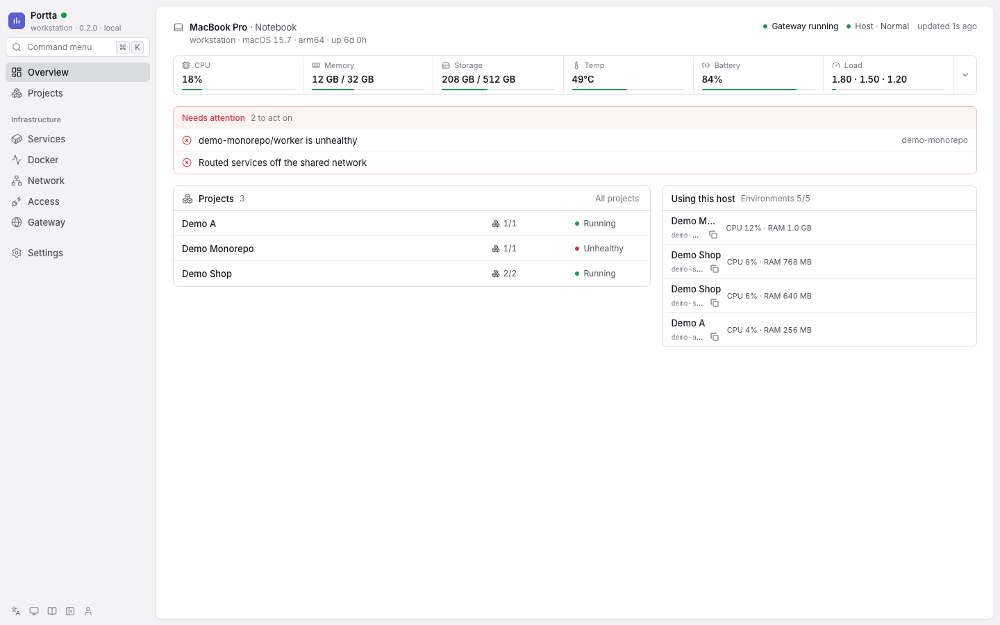

# Portta

Many Docker projects on one host, each at `project-service.<domain>`, with no published ports, private databases, a login per site, and agents of any brand that know all of this when their session starts.

```text
$ portta urls
https://demo-shop-api.portta.example     demo-shop   api
https://demo-shop-web.portta.example     demo-shop   web
https://demo-site-web.portta.example     demo-site   web
```

All of those services listen on the same internal port. None of them publishes a port on the host.



## The problem it solves

Running several projects, branches or agent worktrees side by side on one server breaks down quickly: two stacks want port 3000, nobody remembers which port is which, a database ends up reachable from the internet, and showing a change to a client means exposing something by hand.

## What Portta does

- **Names instead of ports.** One Traefik instance owns ports 80 and 443. Every HTTP service is routed by a hostname derived from its Compose project and service names.
- **Parallel environments.** A Compose project name is a namespace, so a branch or a worktree runs next to the main checkout with its own containers, volumes and URLs.
- **Private databases.** Datastores stay on each project's private network. You reach one through a temporary loopback bridge, never through a published port.
- **A decision per site.** On a public host every routed hostname is protected by a login, open to everybody, or closed because nobody decided. Forgetting leaves it closed. Changing it needs no restart.
- **Access for a client.** A permanent login, or a temporary link that stops working by itself, from the panel or the CLI.
- **Agents that know the host.** `portta agents install` teaches Claude Code, Codex, OpenCode and Pi, at the start of every session, where they are running and what applies. They do the work; Portta decides where it runs and how it is reached.
- **A panel that fits in a phone.** What is running, at which URL, whether it is protected, and the controls to change that.

## What Portta is not

Portta does not run AI, manage git, track issues or deploy releases. It reads where a project's code stands (branch, last commit, what is not committed or pushed) on the host, never asking a remote and never writing to the repository. It gives your tools a place to run projects and a way to reach them. It is host infrastructure installed once, not a parent Compose project, and it never edits your repository.

## Status

`v0.x`: the CLI, the configuration and the panel can change between releases, with no compatibility promise. It is tested locally and in CI. Real DNS and certificate issuance, Cloudflare and Debian 13 have not been exercised by automation; the [deploy guide](docs/product/guides/deploy.md) is written so you can verify them on your own host.

## Requirements

| Requirement | Version |
|---|---|
| Docker Engine with Docker Compose v2 | Engine 24 or newer, Compose 2.24.4 or newer |
| Node.js and npm | Node 24 or newer |
| Operating system | macOS or Linux with a POSIX shell |

Optional: `sqlite3` (`portta db shell` and backups). See the [compatibility reference](docs/product/reference/compatibility.md).

## Install

```bash
npm install -g @codions/portta
portta setup
```

`setup` checks Node, Docker and Compose, asks for one confirmation, installs the runtime into `~/portta`, pulls the pinned images and starts the gateway. `portta setup --dry-run` reports what it would do. To run the installer once without installing the command, use `npx @codions/portta setup`; for daily use install the command globally. See [Install Portta](docs/product/getting-started/install.md).

## Use it in three commands

```bash
portta adopt /path/to/project        # plan the runtime; asks who may open each site on a public host
portta runtime up /path/to/project   # start it behind the gateway
portta urls                          # the routed hostnames
```

On a public host, `adopt` stops until you decide for each routed service: `--protect web` (a generated login, shown once) or `--public api`. Your Compose file is never edited. See [Add your first project](docs/product/getting-started/first-project.md).

## A public host

For a server on the internet, with every project at `project-service.example.com`:

1. Create two DNS-only records pointing at the server: `A example.com` and `A *.example.com`. The wildcard does not cover the domain itself, which is where the panel lives.
2. Create a Cloudflare API token with **Zone, DNS, Edit** on that zone, used to issue one wildcard certificate.
3. On the server, `npm install -g @codions/portta && portta setup`.
4. `portta public init --domain example.com --email you@example.com --cloudflare-token-stdin --yes < token-file` writes the public profile, the domain and the token to `~/portta/.env`; then `portta up remote-public`.
5. `portta dns check && portta doctor`, then open `https://example.com` and create the owner.

The [deploy guide](docs/product/guides/deploy.md) has each step with the exact records and values, and [Run a public host](docs/product/guides/public-host.md) explains the per-site decisions.

## Agents

```bash
portta agents install     # instructions, a session hook and three skills, for the agents on this machine
portta agent context      # what an agent sees at the start of a session
```

The skills (`portta-host-context`, `portta-adopt-compose`, `portta-dockerize`) are also published for `npx skills add codions-labs/portta -g`.

## Security

Nothing is exposed by default: the panel listens on loopback until you say otherwise, datastores stay private, Docker access goes through filtered socket proxies, and on a public host an undecided hostname is closed. Read the [threat model](docs/product/concepts/security.md).

## Develop Portta

```bash
git clone git@github.com:codions-labs/portta.git
cd portta
just dev               # or: ./bin/portta dev
```

See [Develop Portta](docs/development/development-setup.md) and [Testing](docs/development/testing.md).

## Documentation

- [Documentation index](docs/README.md), also served by the panel at `/docs` and by `portta docs`
- [Architecture](docs/product/concepts/architecture.md), [Networking](docs/product/concepts/networking.md), [Security](docs/product/concepts/security.md)
- [Configuration reference](docs/product/reference/configuration.md) and [CLI reference](docs/product/reference/cli.md)
- [Architecture decisions](docs/development/adr/README.md)
- [Changelog](CHANGELOG.md)

## License

MIT. See [LICENSE](LICENSE).
