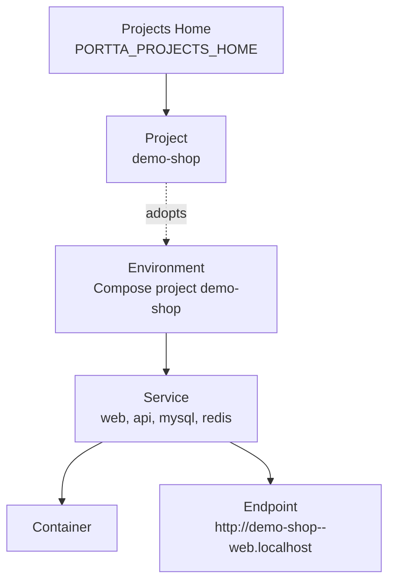

# Projects, environments and services

Portta separates what you **decided** exists from what Docker **observes**
running. A Project is a decision, stored in the panel database. Environments,
services, containers and endpoints are observations, read from Docker every
time. Portta has no Workspace entity: the top of the model is Projects Home.



Solid lines are ownership; dotted lines are links Portta records or infers.

## Projects Home

One directory per installation, `PORTTA_PROJECTS_HOME` (default `~/projects`,
or `/srv/projects` as root). A Project directory sits under it at any depth, and when
one Project's directory contains another's, the deepest directory wins. The
panel receives the path only as a string and never mounts it.
See [ADR 0031](../../development/adr/0031-projects-home-and-project.md).

## Project

The product you work on, such as `demo-shop`. Stored in the panel database with
a slug, a name, a description, its members and, optionally, its directory
relative to Projects Home (a relative path at any depth, never the identity).
A Project does not disappear when nothing is running. It adopts environments by
three sources: `manual`, `label` (a `portta.project` label) and `path` (the
environment's working directory is under the Project's directory).

## Environment

One Compose project, identified by its project name (`COMPOSE_PROJECT_NAME`).
That name is the namespace: it prefixes container names, networks, volumes and
hostnames. Each checkout or worktree needs its own, for example `demo-shop` and
`demo-shop-issue59`.

A Project **adopts** an environment. An environment belongs to at most one
Project, and Portta records why: a `portta.project` label, a working directory
under the Project's directory, or a manual choice. Portta remembers an
environment's working directory and Compose files so it can be started again
after its containers are gone.

## Service and container

A **Service** is one Compose service in an environment: `web`, `api`, `mysql`,
`redis`. Its **containers** are what Docker is running for it, with their state,
health and resource usage. Only HTTP services join the shared `portta` network;
`mysql` and `redis` stay on the environment's private network.

## Endpoint

How a service can be reached. A service has as many endpoints as the host's
capabilities and the operator's choices allow, each with a scope: internal,
local, LAN, private, protected or public. The default HTTP endpoint is derived
from the names:

```text
<compose-project>--<service>.<domain>   →   http://demo-shop--web.localhost
```

See [Addresses and access](addresses-and-access.md) and
[ADR 0024](../../development/adr/0024-capabilities-providers-endpoints.md).

See [Manage projects](../guides/projects.md),
[Manage environments](../guides/environments.md) and
[Persistence](persistence.md) for how these are stored.
