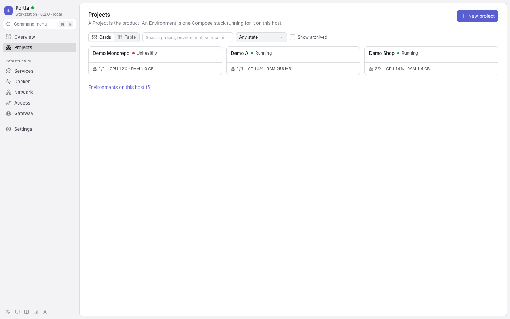
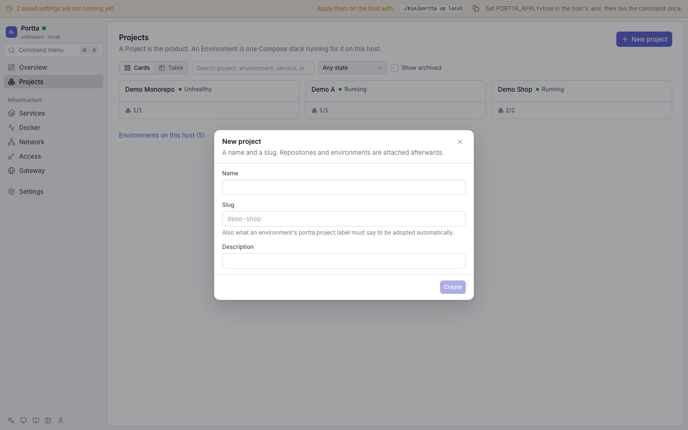

# Add your first project

A Project groups the environments that belong to the same product. An Environment is one Compose namespace.

## Prerequisites

Complete [Configure your first environment](first-environment.md) and open the
panel with `portta web up` and `portta web open`. With authentication enabled,
sign in with an account allowed to create Projects.

## Create the Project

1. Open **Projects**. Existing Projects appear as cards; **Table** switches to a
   table.

   

   **Authentication disabled**: the Projects page.

2. Optionally follow **Environments on this host** (the link under the list) to
   find your environment, such as `demo-shop`, and check that its working
   directory and services belong to your checkout. Then go back to **Projects**.
3. Choose **New project**, enter `Demo Shop` as the name and `demo-shop` as the
   slug, then choose **Create**. The description is optional.

   

   **Authentication disabled**: the New project dialog.

4. Open the Project and inspect its **Environments** tab. Portta attaches a
   running environment to a Project by the first rule that applies, and the tab
   says which one applied to each environment:

   - **linked by hand**: you chose it with **Adopt an environment**;
   - **declared by its `portta.project` label**: a service of the environment
     carries `portta.project=demo-shop`, matching the slug;
   - **it runs from a directory of this project**: the environment's working
     directory is under the directory set in the Project's **Settings**
     (**Directory under Projects Home**, at any depth). When several Projects
     contain it, the deepest directory wins; two Projects on the same
     directory adopt nothing.

   The label does not create the Project. It is the one optional line you add
   to your own Compose file; Portta never edits it.
5. If the environment is not listed, pick it in **Adopt an environment** and
   choose **Adopt**. The select lists the environments no Project has yet.

The same Project can be created from the terminal while the panel is running:

```bash
portta projects create --slug demo-shop --name 'Demo Shop'
```

Add `--path group/demo-shop` to set its directory under Projects Home.

## Expected result

Your Project lists its running environment, with the reason it belongs there,
without moving the project or sharing another environment's state. If they are missing, use
[Troubleshooting](../guides/troubleshooting.md) and verify the labels described
in [Add an existing project](../guides/adopting-projects.md).

See [Manage projects](../guides/projects.md) for ongoing administration. To let
your coding agents (Claude Code, Codex, OpenCode, Pi) learn this host, run
`portta agents install`.
