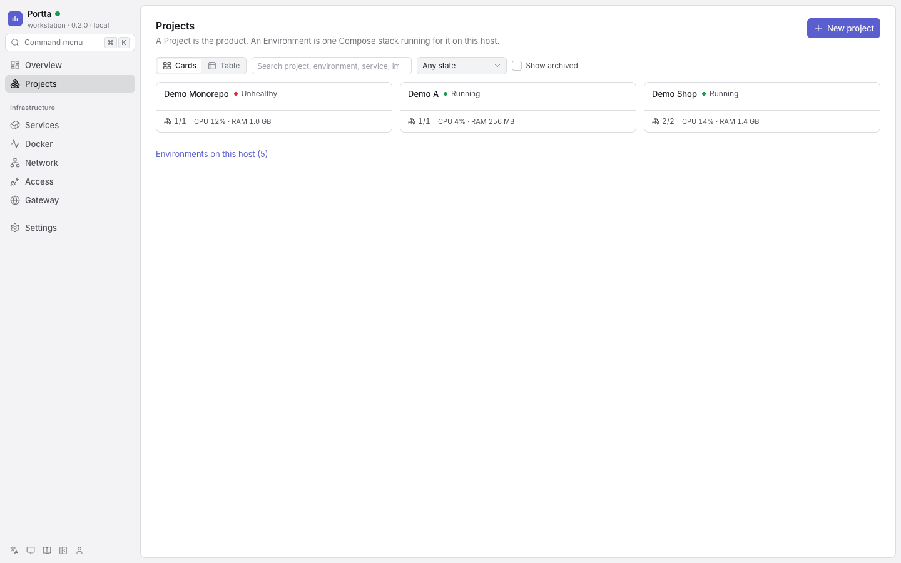

# Manage projects

## Adding from the panel

Settings readers (owners and administrators) see **Add project** list the folders the host collector
found under Projects Home. **Analyze** opens the same report as `portta envs analyze`; choose who may open
each site and register the project, then run the `portta adopt` command the page prepares. The
collector refreshes the list every minute, and the panel never opens the folders itself.

A folder can be listed without a review. The collector does not review a folder whose Compose file or
`.env` is a link, a pipe or too large (over 1 MB and 64 KB), whose Compose file includes or extends a
file outside the folder or fetches something, or that Compose cannot read within 20 seconds. The reason
is in `state/logs/host-metrics.log`. The review is made without resolving variables, so a value that
comes from `.env` or the host shows as written, such as `${PORT}`; `portta envs analyze` on the host
resolves them.

## Projects

Every page below is a route, not a tab held in memory: `/projects`,
`/projects/<slug>`, `/projects/<slug>/environments`, and so on. Each one is a link
somebody can paste, a bookmark that survives a reload, and a step the browser's
back button walks. What a role may not do is not shown rather than shown
disabled.

**Authentication disabled**: Projects as cards.

The products you recognise, each with its environments, or as a table: running
environments, health and resources. **New project** creates one from a name, a slug and a
description; the slug is also what an environment's `portta.project` label must
say to be adopted automatically. A Project may be tied to a directory under
Projects Home at any depth; when two Projects contain a Compose directory, the
deepest one wins. A Project needs the panel's database and the
page says so when it is unavailable. What Docker is running and no Project adopted
is listed under **No project**, and it stays there until someone adopts it: **Adopt into** moves one
environment, and when several run from the same folder **Group into the project** creates the Project from that
folder and puts them all in it. That includes environments the panel only remembers (a worktree or a test run
whose containers are gone). **Forget remembered** drops the ones you do not want to see any more; it never
touches Docker or the disk. From a terminal, `portta projects create --path .` run inside the folder makes the
Project for it, and `--environments a,b` adopts those environments by hand.

A Project can carry **tags** to find it by: `cliente: Acme`, or just `loja`. Type one
beside the Project's name (`+ tag`) and press Enter; up to sixteen, the part before
the first colon is the key and is lowercased, the rest keeps its case. Tags are chips
above the list to filter by, the search finds them, and **Group by** gathers the list
under the values of a key in use (one band per client, with the Projects that have none
last) or by state. A Project with two values of a key appears under each. A tag only
groups and filters: it grants and hides nothing, so whoever may update a Project may tag
it, and the change is in the audit log as `project.tagged`. `PUT /api/projects/{slug}/tags`
replaces them all.

Both views are places to act, not only to look. A Project carries the one action
its state allows (start what is stopped, stop what is running) and a menu
with the rest: environments, settings, archive, delete. An action that could
not change anything is not offered.

The table sorts on any column, hides the ones a given host does not care about,
and selects rows for a bulk start, stop, restart or archive. The arrangement is
remembered per table. Nothing destructive happens without saying what it will
do: stopping a project names its environments and counts its containers,
and deleting one asks for its slug and states what survives.
The panel classifies a Project's location against Projects Home by comparing
paths the host reported; it never mounts Projects Home or any project
directory.

Opening a Project is the cockpit. The header carries its health and an
**Open / Test** menu for its primary environment; below it, tabs that are URLs:

| Tab | What it holds |
|---|---|
| **Overview** | The environments with their services and an Open / Test each, and the resources the project uses |
| **Environments** | The environments adopted, why each was adopted (manual, label or path), and **Adopt** for one that was not |
| **Settings** | Name, description, place under Projects Home, archive, and delete, which removes what only Portta holds and names it |

Deleting a Project never touches a container, a volume, a network or the
project's directory: its environments go back to unassigned.
